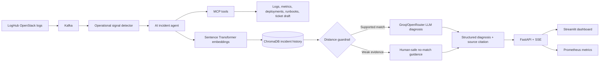
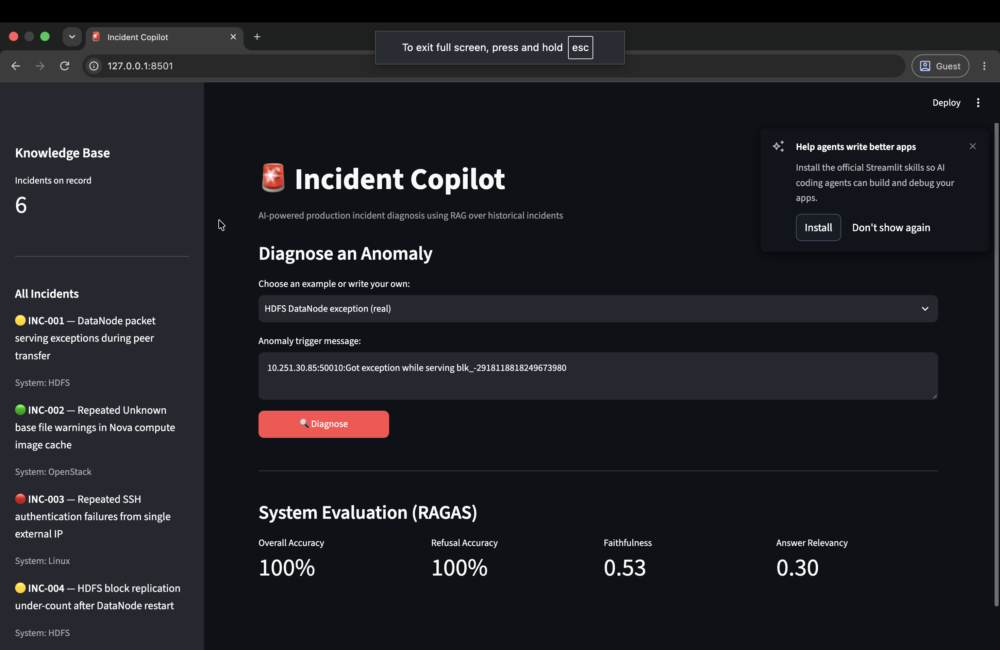

# Incident Copilot

## Evidence-driven investigation agent

The investigation endpoint now connects to the bundled MCP server over stdio,
initializes a session, discovers tools, and calls them through the MCP protocol.
An LLM selects follow-up checks after the initial log lookup. The backend permits
only four read-only tools and rejects repeated or unknown tool selections.

- Logs: searches the latest 1,000 records in the configured log file by component,
  returning at most 20 records. Historical replay logs are not live production data.
- Health: reports status and latency from the triggering event, not an independent
  Prometheus query.
- Deployments: reads GitHub deployments for `GITHUB_REPOSITORY`, using optional
  `GITHUB_TOKEN`. Missing configuration returns unavailable evidence, never a
  fabricated deployment. Repository history alone does not establish causality.
- Runbooks: exposes retrieved historical candidates as supporting context.

Collected evidence reaches the diagnosis prompt. Returned incident IDs must exist
in the retrieved candidates, and source citations are assigned by the backend.
The dashboard displays that same investigation diagnosis, avoiding a second,
independent model diagnosis for each click.

Investigations have a four-tool budget and a 90-second orchestration deadline,
plus MCP and provider timeouts. In-flight synchronous provider requests may finish
after the orchestration deadline; they have no production write capabilities.
Tool failures, invalid planner responses, and weak matches produce
`needs_human_investigation`; other results await human review. Tickets remain
drafts. No tool merges code, rolls back services, or executes shell commands.

Tests include a real MCP subprocess handshake and tool call, with mocked model
decisions and GitHub responses for repeatable offline checks. Real provider
quality and live deployment connectivity require separately configured credentials.

Incident Copilot is an AI-agent-powered production operations system that detects suspicious log activity, investigates with MCP tools, retrieves related historical incidents, and produces a grounded root-cause diagnosis with a recommended remediation. When evidence is weak, it refuses to force a match and escalates the incident to a human engineer.

## Why this project exists

On-call engineers often search old tickets, postmortems, and runbooks while an outage is active. That process is slow, and a superficially similar incident can lead responders toward the wrong fix. Incident Copilot combines real-time detection with evidence-backed retrieval and an explicit refusal path to reduce time spent searching without pretending that every new failure has happened before.

## Architecture



## Dashboard preview



## Key engineering decisions

- **Safe failure over forced matching:** a configurable vector-distance threshold rejects weak evidence before the LLM sees retrieved incidents.
- **Grounded results:** each accepted diagnosis returns the incident ID, title, and runbook/postmortem source used as evidence.
- **Live feedback:** Server-Sent Events expose retrieval, guardrail, and generation progress to the dashboard.
- **Duplicate suppression:** a cooldown prevents a sustained burst from opening the same anomaly repeatedly.
- **Multi-signal detection:** OpenStack logs are inspected for service-level error bursts, 5xx responses, latency spikes, and risky phrases even when no runbook match exists.
- **Agentic investigation:** detected incidents are routed through an AI incident agent that calls MCP tools for logs, metrics, deployments, runbooks, and ticket drafting.
- **Human approval:** the agent drafts recommendations and tickets, but rollback or production-changing actions require human review.
- **Testable boundaries:** Kafka parsing, rate detection, retrieval mapping, refusal behavior, malformed model output, imports, and API validation can be tested without paid LLM calls.
- **Operational visibility:** request IDs, structured service logs, Prometheus request counts, and latency histograms support production debugging.

## Technology

| Layer | Technology |
|---|---|
| Streaming | Apache Kafka with LogHub OpenStack log replay |
| Detection | Python operational signal detector for error bursts, latency spikes, and unknown risky patterns |
| Agent tools | MCP server exposing logs, metrics, deployments, runbooks, and ticket-drafting tools |
| Retrieval | ChromaDB + `all-MiniLM-L6-v2` embeddings |
| Generation | Configurable Groq or OpenRouter LLM with structured Pydantic output |
| API | FastAPI, Server-Sent Events |
| Interface | Streamlit |
| Evaluation | RAGAS, labeled retrieval benchmark, keyword baseline |
| Operations | Docker Compose, Prometheus metrics, GitHub Actions |

## Example result

## Real-time LogHub replay

The Kafka producer can replay public LogHub datasets as if they were live production logs. By default, Docker Compose now uses `OpenStack_2k.log`, which gives the demo a cloud-infrastructure incident story instead of only HDFS examples.

```bash
LOG_SOURCE=OpenStack LOG_FILE_PATH=data/OpenStack_2k.log python producer.py
```

## LLM provider

Groq is the default provider:

```env
LLM_PROVIDER=groq
GROQ_API_KEY=replace_with_your_key
GROQ_MODEL=openai/gpt-oss-20b
```

OpenRouter is also supported by setting `LLM_PROVIDER=openrouter` and adding `OPENROUTER_API_KEY`.

## MCP server

The project includes an MCP server that exposes incident-investigation tools to an agent client:

```bash
python mcp_server.py
```

The local MCP config is in `mcp.json` and registers the `incident-copilot` server.

Available MCP tools:

- `search_recent_logs`
- `get_service_health`
- `get_recent_deployment_evidence`
- `search_incident_runbooks`

Interview version:

```text
I used real OpenStack system logs from LogHub and replayed them through Kafka to simulate live production incidents for the AI incident agent to investigate.
```

Input:

```text
10.251.30.85:50010: Got exception while serving blk_-2918118818249673980
```

Structured output:

```json
{
  "matched_incident_id": "INC-001",
  "confidence": "high",
  "likely_root_cause": "Network saturation or peer DataNode overload during replication.",
  "suggested_fix": "Inspect rack utilization and throttle replication bandwidth.",
  "sources": [
    {
      "incident_id": "INC-001",
      "title": "DataNode packet serving exceptions during peer transfer",
      "source": "data/incidents.json"
    }
  ]
}
```

For a novel payment, frontend, or mobile failure, the expected behavior is `confidence: "no_match"` with a human-escalation recommendation.

## Evaluation

The repository separates two evaluation layers:

1. `evaluate_retrieval.py` runs an offline 91-case benchmark containing 72 known-incident variations and 19 novel-domain cases. It reports Recall@1, Recall@3, mean reciprocal rank, precision, recall, F1, confusion matrix, per-domain results, retrieval latency, and a keyword-search baseline.
2. `evaluate_diagnosis.py` evaluates full LLM diagnoses. It reports match/refusal accuracy, precision, recall, F1, false-positive rate, confusion matrix, per-domain accuracy, latency, RAGAS faithfulness, and answer relevancy.

Latest local offline retrieval benchmark:

| Metric | Result |
|---|---:|
| Cases | 91 |
| Positive / novel cases | 72 / 19 |
| Recall@1 / Recall@3 | 1.00 / 1.00 |
| MRR | 1.00 |
| Match precision / recall / F1 | 1.00 / 0.97 / 0.99 |
| False-positive rate | 0.00 |
| Keyword baseline accuracy | 1.00 |
| Warm mean / P95 retrieval latency | 20.0 ms / 127.0 ms |

These numbers are useful portfolio evidence, but they should be described as a curated offline benchmark. The keyword baseline also scores 1.00, which shows the current benchmark is still too easy to claim production-grade semantic retrieval. The older saved full-LLM result came from the original **five-case** experiment: 100% match/refusal accuracy, 0.528 faithfulness, and 0.304 answer relevancy. Keep that result qualified until the full 91-case LLM evaluation is rerun with a valid `OPENROUTER_API_KEY` or `GROQ_API_KEY`.

## Reliability and safety controls

- Configurable model, Kafka address, retrieval depth, threshold, timeout, retries, anomaly window, and cooldown
- Human escalation for weak retrieval results
- Fail-safe `no_match` response for malformed LLM output
- Persistent ChromaDB volume and persisted diagnosis history
- Kafka consumer groups and producer retries
- API request correlation through `X-Request-ID`
- Prometheus metrics at `/metrics`
- CORS configuration intended for local development only

## Knowledge-base expansion

The starter catalog contains 18 demonstration incidents across HDFS, OpenStack, Linux, Spark, Kafka, Kubernetes, PostgreSQL, Redis, Nginx, Airflow, Elasticsearch, AWS S3, Celery, Prometheus, CoreDNS, and GitHub Actions. `import_runbooks.py` accepts JSON or JSONL incident records, validates required fields, records their source paths for citation, and updates the catalog. The vector index is rebuilt after import.

Required fields are:

```text
id, title, log_pattern, system, symptoms, root_cause,
fix, severity, resolution_time_minutes
```

## Automated quality checks

The GitHub Actions workflow runs Ruff and Pytest on pushes and pull requests. Tests cover:

- HDFS log parsing
- Invalid-log rejection
- Sliding-window threshold behavior
- Window expiration and cooldown
- API health, request IDs, input validation, and 404 responses
- Vector-result mapping and source citations
- Distance-based novel-incident rejection
- Safe handling of malformed LLM responses
- Runbook schema validation

## Known limitations

- The included incident catalog is intentionally small and illustrative.
- The labeled benchmark uses curated variations and is not a substitute for production traffic.
- The detector currently uses a rate threshold rather than a learned anomaly model.
- Diagnosis quality depends on the coverage and accuracy of imported incident records.
- The development API permits all CORS origins and does not yet include user authentication.
- The Streamlit dashboard is a demonstration interface, not a multi-tenant operations console.


## Data attribution

Example infrastructure logs are sourced from the public [Loghub](https://github.com/logpai/loghub) datasets. The included incident summaries are project demonstration records built around common operations domains, not claims about real production outages.
